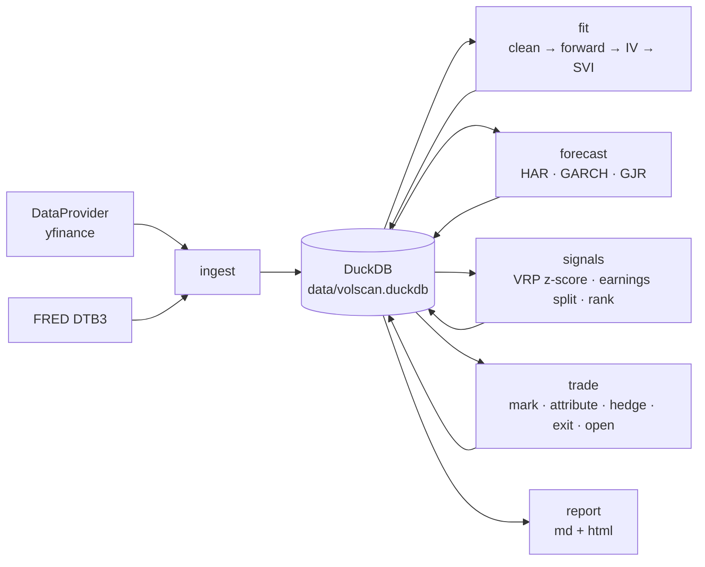

# iv-rv-scanner

A nightly scanner that compares what the options market *implies* about future
volatility with what a set of time-series models *forecast*, flags the names
where the gap is unusual, and runs a delta-hedged paper book on those flags so
I can see whether the signal actually makes money once hedging and costs are
paid for.

> **Research and paper trading only.** This is not investment advice. The code
> never sends orders and contains no broker execution code.

What a run produces (`reports/output/YYYY-MM-DD.md` and `.html`):

```
NVDA 30-day IV 52.3 vs forecast 40.2: +12.1 vol pts (z = +2.3, earnings in window: no) → RICH
```

plus the ranked table for the whole universe, smile and term-structure charts
for the top flags, open positions with their Greeks, and a cumulative P&L chart
that splits **what the volatility view earned** from **what hedging and
transaction costs cost**.

---

## Quickstart

```bash
git clone https://github.com/vivaans07/iv-rv-scanner.git
cd iv-rv-scanner
uv sync --group dev
cp .env.example .env          # optional: add a FRED key
uv run volscan run-daily --tickers SPY,AAPL,NVDA,JPM,XOM --force
open reports/output/*.html
```

`--force` runs even on a weekend or holiday (the data is then the last
session's close). Without `--tickers` the full ~50-name universe in
`config/universe.yaml` is scanned, which takes several minutes, mostly in
yfinance downloads and SVI fits.

Individual steps can be run on their own, and each one is idempotent for a
given day:

```bash
uv run volscan ingest      # snapshot chains, prices, earnings dates, the T-bill rate
uv run volscan fit         # quote cleaning, implied vols, SVI surfaces
uv run volscan forecast    # HAR, GARCH, GJR-GARCH and the ensemble
uv run volscan signals     # VRP-adjusted z-scores and ranking
uv run volscan trade       # mark, hedge, exit, and open paper positions
uv run volscan report      # Markdown + HTML report
uv run volscan backtest --start 2026-11-02 --end 2026-12-31   # replay stored days
```

`backtest` replays snapshots already in the local database through signals and
a separate `backtest` paper book. Free data has no historical option chains, so
the replay window is whatever the nightly job has collected so far.

### Development

```bash
uv run ruff check . && uv run ruff format --check .
uv run mypy
uv run pytest
uv run pre-commit install      # gitleaks, detect-secrets, nbstripout, ruff
```

The test suite never touches the network. Data providers are replaced with a
deterministic fake (`tests/fakes.py`) and the rate lookup is forced to its
fallback.

---

## Configuration

| File | What it holds |
|---|---|
| `config/universe.yaml` | Tickers to scan and which of them are ETFs (no earnings). |
| `config/settings.yaml` | Every threshold: quote filters, liquidity screen, SVI restarts, forecast windows, entry/exit z, sizing, costs, hedge vol. |
| `.env` | Optional secrets and path overrides (see `.env.example`). Never committed. |

Useful knobs:

- `signals.entry_z` / `signals.exit_z`: open at \|z\| ≥ 1.5, close when \|z\| < 0.5 or the sign flips.
- `signals.trade_through_earnings`: by default a name with earnings inside the
  30-day window is only traded if the event variance could be stripped out
  first (see below).
- `paper.hedge_vol`: `implied` or `forecast`. Changing this is the easiest way
  to see how much the hedge vol matters (the difference lands in the
  `residual` P&L column).
- `paper.vega_per_vol_point`: position size in dollars per vol point (default $1,000).

---

## Architecture



```
src/volscan/
  data/        provider interface, yfinance, DuckDB store, rates, earnings, ingest
  pricing/     Black-76 / BSM prices, Greeks, implied-vol solver
  surface/     quote cleaning, parity forwards, raw SVI, arbitrage checks, term structure
  forecast/    realized-variance proxies, HAR-RV, GARCH, ensemble + evaluation
  signals/     VRP scoring, earnings variance split, ranking
  paper/       positions, hedger, costs, attribution, GBM simulator
  report/      daily report and templates
  pipeline.py  the nightly steps wired to the store
  cli.py       `volscan` commands
```

Everything a step writes is keyed by `asof` (the session date), so re-running a
step replaces that day's rows. Paper positions are stored as one state row per
position per day, and a trading step for day D starts from each position's
state on the last day before D, so re-running D gives identical results.

---

## Methodology

### 1. Data

Each night, for every ticker: daily OHLCV history (4 years), every option
expiry between 7 and 180 calendar days out, and past and upcoming earnings
dates. The 3-month T-bill (FRED `DTB3`) is the risk-free rate. It is quoted on
a bank-discount basis, so it is converted to a continuous rate:

$$ r = -\frac{\ln(1 - d \cdot 91/360)}{91/365} $$

Failures are retried with exponential backoff. One bad ticker is logged and
reported but never stops the run.

**About the data.** yfinance is an unofficial scraper of Yahoo Finance and is
for personal research. Quotes can be delayed, stale, or missing, especially
outside market hours. A snapshot taken on a weekend shows Friday's last quotes,
and some bids show as zero.

### 2. Quotes, forwards, implied vols

- Quotes are dropped if the bid is zero, the market is crossed, the spread is
  wider than 25% of mid, or open interest is below a floor.
- **Forward from put-call parity.** For each expiry, $F = K + (C - P)/DF$ on
  the five strikes where $|C - P|$ is smallest (the money is where calls and
  puts cost the same). The median is used. This absorbs dividends and borrow
  without modeling them, and it does not depend on the reported spot, which
  is often captured at a slightly different time than the chain.
- **OTM only.** Listed US equity options are American. I price them as European
  options on the forward with Black-76 and keep only out-of-the-money quotes
  (puts below F, calls above). OTM American options carry almost no
  early-exercise premium, so the approximation is small there. Deep ITM
  quotes, where it would matter, are not used.
- **IV solver.** Newton's method on vega from a Brenner-Subrahmanyam starting
  guess, with a Brent fallback on [0.0001, 5]. Prices outside the no-arbitrage
  bounds return NaN.

### 3. SVI surface

Each expiry is fit with raw SVI on total implied variance $w = \sigma^2 T$ in
log-moneyness $k = \ln(K/F)$:

$$ w(k) = a + b\left(\rho (k - m) + \sqrt{(k - m)^2 + \sigma^2}\right) $$

- For fixed $(m, \sigma)$ the model is linear in the other three parameters.
  A grid of linear least-squares solves gives starting points cheaply. This
  is the quasi-explicit idea from Zeliade.
- The best starts are polished with bounded L-BFGS-B using an analytic
  gradient, with $a$ reparameterized as the minimum variance
  $v = a + b\sigma\sqrt{1-\rho^2} \ge 0$ so every constraint is a simple bound.
  Quotes are weighted by vega.
- **Butterfly arbitrage**: Gatheral's density condition
  $g(k) = \left(1 - \frac{k w'}{2w}\right)^2 - \frac{w'^2}{4}\left(\frac{1}{w} + \frac14\right) + \frac{w''}{2} \ge 0$
  is checked across the quoted strike range.
- **Calendar arbitrage**: total variance must not fall as maturity increases at
  any fixed $k$.
- Violations are flagged in `svi_slices`, not silently repaired.

From the fits: ATM vol, 25-delta risk reversal and butterfly per expiry, and
constant-maturity 30/60/90-day values. Those come from interpolating total
variance linearly in calendar time between the bracketing expiries, with vol
held flat outside the quoted range.

### 4. Realized-vol forecasts

Daily variance proxies from OHLC: close-to-close, Parkinson, Garman-Klass, and
a Yang-Zhang-style proxy (overnight gap squared plus Rogers-Satchell), which
is the primary one. The rolling Yang-Zhang estimator is also implemented.

- **HAR-RV** (Corsi): regress the average variance over the *next h sessions*
  on the daily, 5-day, and 22-day averages. A separate regression per horizon
  forecasts the h-day average directly instead of iterating a one-step model.
- **GARCH(1,1)** and **GJR-GARCH(1,1)** with Student-t shocks on percentage log
  returns (the `arch` package). Daily variance forecasts are summed over the
  horizon.
- **Ensemble**: weights proportional to 1 / out-of-sample QLIKE, refreshed
  weekly per ticker.
- Earnings reaction days are neutralized before fitting so the forecast is of
  *diffusive* vol. The jump is handled separately by the earnings split below,
  and counting it in both places would double-count it.

**Day counts.** This is easy to get wrong, and getting it wrong biases every
signal. IV is quoted on calendar time (ACT/365). Realized variance only
accrues on trading days. I compare them as **total variance over the same
window**: the IV gives $\sigma_{imp}^2 \cdot D/365$ for a $D$-calendar-day
tenor, and the forecast gives the sum of daily variances over the NYSE
sessions that actually fall in those $D$ days, counted with the exchange
calendar, holidays included. The forecast is then reported as an annualized
vol on the same calendar basis, $\sqrt{\text{total}/(D/365)}$.

**Out-of-sample evaluation** (non-overlapping 21-session windows over the most
recent 40% of history, realized target = summed Yang-Zhang proxy, lower is
better). Results from the first live run on 2026-10-16, 20 windows per ticker:

| QLIKE | HAR | GARCH | GJR-GARCH |
|---|---:|---:|---:|
| SPY | 0.349 | 0.277 | **0.204** |
| AAPL | 0.284 | 0.229 | **0.156** |
| NVDA | 0.176 | 0.122 | **0.121** |
| JPM | 0.198 | **0.184** | 0.188 |
| XOM | **0.140** | 0.235 | 0.198 |
| Mean | 0.229 | 0.210 | **0.173** |

GJR-GARCH wins most often. The leverage term matters for equity indices and
large caps, where vol rises after down moves. HAR is worst on average but best
on XOM. This is a small sample (100 windows in total) and will be re-run as
the scanner collects more days. The per-ticker scores are stored in the
`forecast_eval` table.

### 5. Signals

**Raw spread** = IV − forecast, in vol points, at 30 days (primary) and 60 days.

**Variance-risk-premium adjustment.** Option sellers are paid to carry crash
risk, so implied vol sits above later realized vol most of the time. A raw
spread would call nearly everything rich. Each spread is therefore scored
against that ticker's own trailing year of spreads: a z-score, plus the excess
over its rolling median.

Free data has no option history, so on a new install there is nothing to
compare against. Until a ticker has 40 stored days, it is scored
**cross-sectionally** instead: the robust z-score (median/MAD) of
$\ln(IV/\text{forecast})$ across the universe that day. The report labels each
score `time-series` or `cross-sectional`.

**Earnings.** A scheduled event adds a one-off jump on top of normal variance:

$$ \sigma_{imp}^2 T = \sigma_{base}^2 T + \sigma_{event}^2 $$

With one expiry strictly before the announcement and one strictly after,
$\sigma_{base}$ comes from the first and $\sigma_{event}$ is what is left in the
second. If every expiry is after the event, two of them identify both
unknowns. An expiry *on* the announcement date is skipped because its meaning
depends on whether the company reports before the open or after the close.
The report compares the implied move with the stock's average absolute
earnings-day move over the last 10 events. If a tenor spans earnings, the
signal uses the ex-earnings IV. By default such names are only traded if that
split succeeded.

**Ranking.** Sort by \|z\| among liquid names. The top 5 rich and top 5 cheap
with \|z\| ≥ 1.5 become candidates.

### 6. Paper trading

- **Instrument**: the ATM straddle (strike nearest the forward) at the expiry
  nearest 30 days. RICH → short, CHEAP → long.
- **Size**: $1,000 of vega per vol point per position, at most 10 positions and
  $10,000 of total vega.
- **Fills**: mid ± 50% of the half-spread, on entry and exit. A straddle is
  skipped if either leg is quoted wider than 15% of mid at the traded expiry.
- **Hedge**: every close, shares are traded to bring delta back to zero. Delta
  is computed at the surface IV, or at the forecast vol if
  `hedge_vol: forecast`. Stock costs are 1 bp of notional (configurable).
- **Exit**: after 10 trading days, when \|z\| < 0.5 or the sign flips, or 5
  days before expiry.
- **Housekeeping**: splits restate strike, contracts, and shares so there is
  no fake P&L jump. A missing quote is marked from the SVI surface (flagged
  `model_mark`). A ticker with no data carries its mark forward (flagged
  `stale_mark`) and is closed after 3 days. Short ITM legs with almost no
  time value are flagged `assignment_risk`.

### 7. P&L attribution

For each position each day, using the previous close's Greeks:

| Component | Formula | Meaning |
|---|---|---|
| Gamma/theta carry | $\tfrac12 \Gamma S^2 \left[(\Delta S/S)^2 - \sigma_{imp}^2\,\Delta t\right]$ | Realized variance vs the variance priced in. This is the VRP trade itself. |
| Vega | $\sum_{legs} \mathcal{V}\,\Delta\sigma$ | The surface moving. |
| Residual delta | $(\Delta_{imp} + \text{shares})\,\Delta S$ | Zero when hedging at implied vol. Non-zero when the hedge uses another vol. |
| Hedging error | everything else in the mark-to-market P&L | Discrete rebalancing, jumps, vanna/volga, rates. |
| Costs | option half-spreads on entry/exit + stock costs | Reported separately. |

The total is computed independently from a cash ledger (equity = cash + option
marks + shares × spot, and every fill moves cash). Each step checks that the
components add up to the ledger P&L and raises if they don't.

"**Signal earned**" = gamma/theta + vega. "**Hedging and costs**" = hedging
error + residual + costs. The report also shows hit rate, average P&L per
trade, Sharpe of daily book P&L, max drawdown, and P&L split rich vs cheap and
earnings vs non-earnings.

A GBM simulator (`volscan.paper.simulate`) runs the same hedger on synthetic
paths. The tests use it to check the basics:

- With realized vol equal to implied, the mean hedged P&L is zero.
- With realized below implied, a short straddle earns positive carry.
- An overnight gap shows up as hedging error.

---

## Concepts, in plain language

**Greeks.** How an option's price reacts to things changing.
- *Delta*: change in price per $1 move in the stock. A straddle starts near
  zero delta.
- *Gamma*: how fast delta changes. Long gamma means the position gets longer
  as the stock rises and shorter as it falls, so re-hedging locks in profits
  from movement.
- *Theta*: what the option loses each day just from time passing. It is the
  rent a long-gamma holder pays.
- *Vega*: change in price per 1-point change in implied vol.
- *Vanna* (how delta moves with vol) and *volga* (how vega moves with vol)
  are second-order effects. They are computed for learning and end up inside
  hedging error.

**The smile and skew.** If the Black-Scholes model were right, every strike
would have the same implied vol. In practice, out-of-the-money puts trade at
higher vols than calls, because crashes happen faster than rallies and
investors pay up for protection. The *25-delta risk reversal* (call vol minus
put vol) measures that tilt and is negative for almost every stock. The
*butterfly* measures how curved the smile is.

**Term structure.** Implied vol differs by expiry. Normally it slopes gently
upward. It inverts when near-term fear is high, and it shows a bump at the
expiry right after an earnings date.

**Variance risk premium.** Implied vol is usually *higher* than the vol that
actually follows, because sellers of options are taking on crash risk and
want to be paid for it. That is why "IV above forecast" is the normal state
and why the signal asks whether the gap is *unusually* large or small for
that name.

**Why delta hedging leaks money.** In theory, a delta-hedged option earns
exactly $\tfrac12\Gamma S^2(\sigma_{realized}^2 - \sigma_{implied}^2)$. In
practice:
- *Discrete rebalancing*: hedging once a day instead of continuously leaves
  noise that averages out but adds variance.
- *Gamma path dependence*: gamma is highest at the strike, so the same
  realized vol pays very differently depending on whether the stock moved
  near the strike or far from it.
- *Hedging at the wrong vol*: the delta you hedge with depends on which vol
  you plug in, and the wrong one leaves a directional bet.
- *Jumps*: an overnight gap moves the stock before you can re-hedge, which
  hurts short-gamma positions the most.
- *Transaction costs*: every rebalance and both option trades pay a spread.

The attribution splits these out so the cost of running the view is visible.

**Earnings and IV.** Before an announcement, the expiries that cover it carry
an extra lump of variance for the expected jump. Then IV collapses the
morning after ("vol crush"). Without separating that lump, every name with
upcoming earnings would look rich and every name just after would look cheap.

---

## Limitations

- **Free, delayed data.** yfinance quotes can be stale or missing, and weekend
  snapshots show Friday's last quotes. A paid feed with timestamps would
  remove a lot of noise.
- **American options priced as European.** This is reasonable for OTM quotes.
  It is wrong for deep ITM options, which are not used, and it is approximate
  for the straddle's ITM leg as the stock moves.
- **Daily OHLC realized-variance proxies.** True intraday realized variance
  (sums of squared 5-minute returns) would be far more precise. A single
  day's range is a very noisy estimate of that day's variance.
- **Survivorship.** The universe is today's liquid names.
- **No borrow, dividend, or financing model.** Parity forwards absorb these in
  pricing, but the hedge ignores dividends paid on shares and the cost of
  carrying cash and stock.
- **Short history.** The time-series z-scores need about 40 nightly snapshots
  per name. Until then the cross-sectional fallback is used.
- **Daily marks only.** No intraday risk, and early exercise is only flagged,
  not simulated.

## Scheduling

The daily job should run after the close, about 5:15 pm New York time on
weekdays. `volscan run-daily` exits quietly on weekends and NYSE holidays
(using `exchange-calendars`).

**cron** (machine on US Eastern time):

```bash
crontab -e
# 15 17 * * 1-5 /path/to/iv-rv-scanner/scripts/run_daily.sh
```

**launchd on macOS**: copy `scripts/com.volscan.daily.plist.example` to
`~/Library/LaunchAgents/com.volscan.daily.plist`, replace `REPO_DIR` with your
clone's path, and run `launchctl load` on it.

The job is deliberately not run in GitHub Actions. The database, positions,
and reports live locally and are gitignored. To move it to a server later,
keep the database on persistent storage and put any API keys in that
platform's secret store rather than in the repo.

## Disclaimer

This project is for research and education. It is not investment advice, it
does not recommend any security or trade, and it does no live trading.
Options are risky, and paper results ignore many real-world frictions.

## License

MIT
